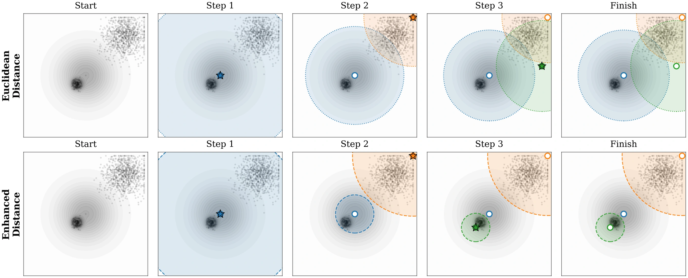
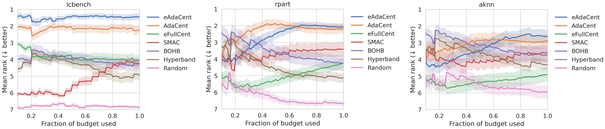
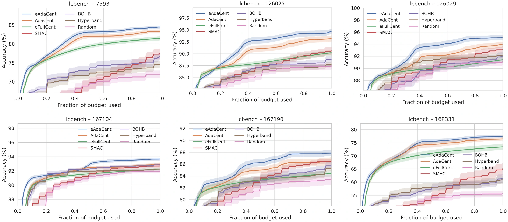
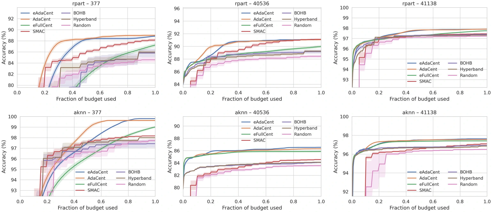

# Hyperparameter Optimization via Budget Allocation in Lipschitz Spaces

Code for the paper [**Hyperparameter Optimization via Budget Allocation in Lipschitz Spaces**](https://arxiv.org/pdf/2510.10605) (KDD 2027).

Hyperparameter optimization and model selection often require allocating a limited evaluation budget across many candidate configurations, where performance improves with additional training or resources. We study this setting when each configuration has an unknown performance curve over budget. Similarity between configurations induces similarity between their curves, capturing geometric structure in the search space. We formalize the resulting decision problem as Unknown Value Probing and propose budget allocation strategies that combine principled exploration of the configuration space with value-informed concentration on regions supported by observed evidence. We prove worst-case approximation guarantees for our approach and show these guarantees are near-optimal by matching corresponding hardness barriers. Extensive experiments on large benchmark suites spanning more than 250 experimental settings demonstrate consistent gains over strong baselines in both anytime behavior and final incumbent performance.

<p align="center"></p>
<p align="center"><em>Figure 1. Enhanced distance expands the coverage of lower-value centers, changing which region the algorithm explores next.</em></p>

## Installation

Use Python 3.10 and run the commands from the repository root.

```bash
python3.10 -m venv .venv
source .venv/bin/activate
python -m pip install -r main/HPO/requirements.txt

git clone --depth 1 https://github.com/slds-lmu/yahpo_data.git data/yahpo_data
export YAHPO_LOCAL_CONFIG="$PWD/.yahpo-gym.yml"
python -c 'from pathlib import Path; from yahpo_gym import local_config; local_config.init_config(str(Path("data/yahpo_data").resolve()))'
```

Keep `YAHPO_LOCAL_CONFIG` set to that absolute path when running experiments in a new shell. An existing [YAHPO Gym](https://github.com/slds-lmu/yahpo_gym) setup also works.

For the full HPO comparison, install the SMAC dependencies with `python -m pip install -r main/HPO/requirements-smac.txt`. For the Bayesian optimization experiments, install `python -m pip install -r main/MFBO/requirements.txt`.

## Running experiments

### Hyperparameter optimization

Run the two adaptive methods on one LCBench task with one seed and a reduced sample count for estimating the smoothness parameter.

```bash
python -m main.HPO.run --config main/HPO/configs/lcbench.json \
  --task 3945 --seeds 0 --methods AdaCent EnhancedAdaCent \
  --epsilon-samples 128 --output outputs/smoke/lcbench
```

Run the methods shown in the paper across all tasks and seeds.

```bash
for suite in lcbench rbv2_rpart rbv2_aknn; do
  python -m main.HPO.run --config "main/HPO/configs/$suite.json" --all-tasks \
    --methods AdaCent EnhancedAdaCent EnhancedFullCent "Random Search" Hyperband BOHB SMAC
done
```

Each [suite configuration](main/HPO/configs/) defines the budget and method parameters. Runs default to seeds 0–29. Enhanced methods estimate ε once per task using 10,000 Sobol configurations by default. Those evaluations are outside the optimization budget. Repeat `--task` to select several tasks or pass `--seeds 0 1 2` to change the seeds.

Each suite writes per-task plots, mean and standard-deviation traces in `avg_traces/`, and a ZIP of the traces to `outputs/<suite>/`. Each trace tracks the best validation accuracy observed at each point on the common budget horizon. Hyperband, BOHB, and SMAC run their configured schedules, which can extend past that horizon. Reported traces stop at the configured comparison budget.

### Multi-fidelity Bayesian optimization

The appendix comparison uses Hydra configurations for `lcbench`, `iaml_rpart`, and `iaml_xgboost`. The methods include both adaptive variants, random search, multi-fidelity Knowledge Gradient (KG), Max-value Entropy Search (MES), and variants of rMFBO.

```bash
python -m main.MFBO.run problem=lcbench algorithm=adacent algorithm.find_best=false
python -m main.MFBO.run problem=lcbench algorithm=enhanced_adacent algorithm.find_best=false
python -m main.MFBO.run problem=iaml_xgboost algorithm=rmfbo_pseudo
```

See the available [problem](main/MFBO/configs/problem/) and [algorithm](main/MFBO/configs/algorithm/) configurations. Set `algorithm.find_best=true` to search an AdaCent parameter grid. Checkpoints resume matching runs by default. Use `checkpoint.enabled=false` to disable checkpointing or `checkpoint.reset=true` to restart a run.

MFBO writes numeric records, checkpoints, figures, and Hydra logs under `outputs/mfbo/`. If you have an earlier checkout with results in `MFBO/res/`, move its `records/` and `checkpoints/` directories into `outputs/mfbo/` to reuse them.

```bash
python -m main.MFBO.plot_accuracy --problem LCBench --methods AdaCent EnhancedAdaCent
```

The plotter summarizes the best observed objective at target fidelity across repetitions, with standard-error bars. The metric is validation balanced accuracy for LCBench and AUC for the IAML scenarios.

## Methods

| Method | HPO option | Budget allocation |
| --- | --- | --- |
| FullCent | `FullCent` | Full-fidelity evaluations at greedy k-center representatives |
| Enhanced-FullCent | `EnhancedFullCent` | Full-fidelity evaluations with value-aware center selection |
| AdaCent | `AdaCent` | Greedy k-center coverage with adaptive pruning |
| Enhanced-AdaCent | `EnhancedAdaCent` | Value-aware center selection with adaptive pruning |

## Results

The experiments use training epochs as fidelity for LCBench and the training-set fraction for the two rbv2 scenarios. Figure 2 averages ranks over 35 LCBench tasks, 107 RPart tasks, and 118 AKNN tasks, with 30 runs per task. Lower rank is better.

<p align="center"></p>
<p align="center"><em>Figure 2. Mean rank as a function of the fraction of the total budget spent.</em></p>

<p align="center"></p>
<p align="center"><em>Figure 3. Anytime validation accuracy on six representative LCBench tasks.</em></p>

<p align="center"></p>
<p align="center"><em>Figure 4. Anytime validation accuracy on three datasets for RPart (top) and AKNN (bottom).</em></p>

## Citation

The current arXiv record uses the title below.

```bibtex
@article{bateni2025budgetallocation,
  title   = {Budget Allocation for Unknown Value Functions in a Lipschitz Space},
  author  = {Bateni, MohammadHossein and Esfandiari, Hossein and HosseinGhorban, Samira and Mirrokni, Alireza and Shahdaei, Radin},
  journal = {arXiv preprint arXiv:2510.10605},
  year    = {2025}
}
```
