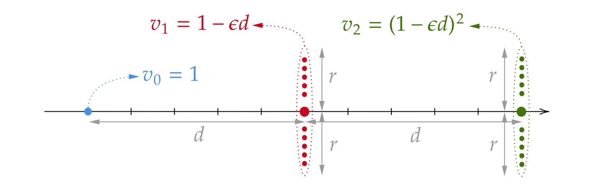
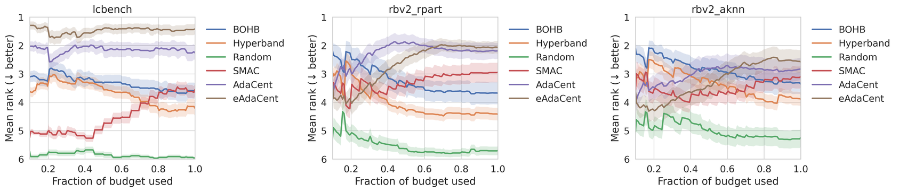
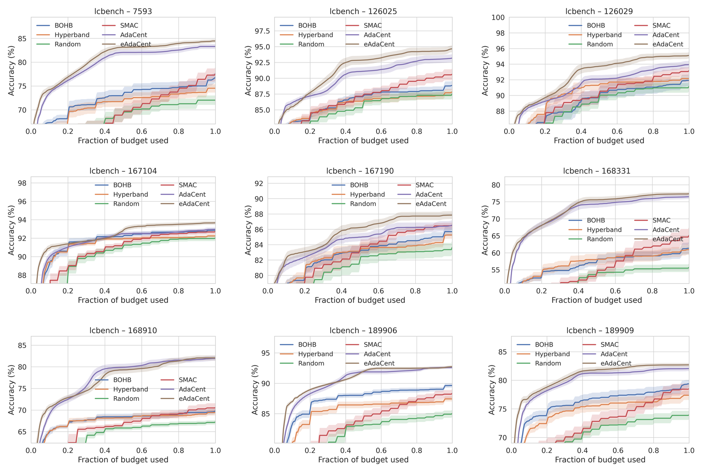
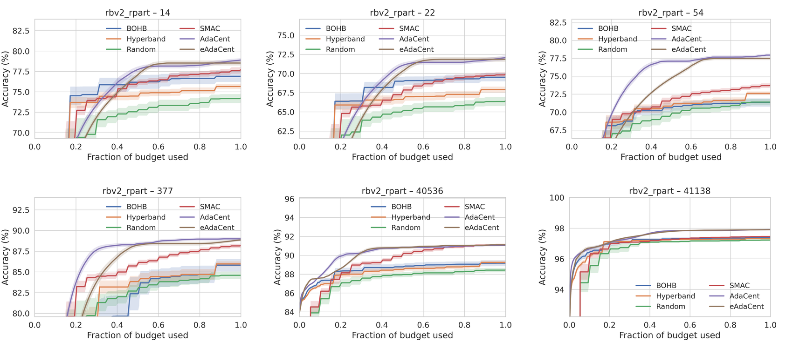
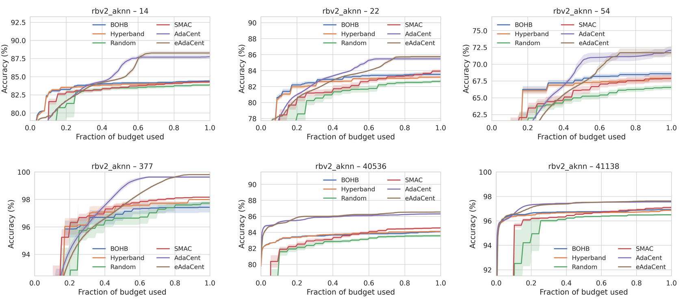

# Budget Allocation for Unknown Value Functions in a Lipschitz Space

Code for [**Budget Allocation for Unknown Value Functions in a Lipschitz Space**](https://arxiv.org/pdf/2510.10605) by MohammadHossein Bateni, Hossein Esfandiari, Samira HosseinGhorban, Alireza Mirrokni, and Radin Shahdaei.

Hyperparameter search has a limited evaluation budget, and a configuration's performance is revealed as it receives more training resources. The paper studies how to allocate that budget when nearby configurations have related learning curves. **AdaCent** uses greedy k-center clustering to cover the configuration space and stops evaluations whose projected performance is low. **Enhanced-AdaCent** also uses observed performance when choosing which configurations to evaluate next.

<p align="center"></p>
<p align="center"><em>Figure 1. In this example, the value-aware distance favors a clustering that includes the optimal blue point.</em></p>

## Installation

Use Python 3.10. From the repository root, install the dependencies and configure the YAHPO Gym surrogates:

```bash
python3.10 -m venv .venv
source .venv/bin/activate
python -m pip install -r HPO/requirements.txt

git clone --depth 1 https://github.com/slds-lmu/yahpo_data.git data/yahpo_data
export YAHPO_LOCAL_CONFIG="$PWD/.yahpo-gym.yml"
python -c 'from pathlib import Path; from yahpo_gym import local_config; local_config.init_config(str(Path("data/yahpo_data").resolve()))'
```

Set `YAHPO_LOCAL_CONFIG` again in each new shell, or use your existing [YAHPO Gym installation](https://github.com/slds-lmu/yahpo_gym). The full comparison also uses SMAC 1.4. Install it with `python -m pip install -r HPO/requirements-smac.txt`. Linux wheels for its `pyrfr` dependency are available for Python 3.10 on x86-64 and ARM64.

## Running experiments

Start with one task and seed. This example runs the two adaptive methods and reduces the number of samples used to estimate the Lipschitz parameter `ε`.

```bash
python -m HPO.run --config HPO/configs/lcbench.json \
  --task 3945 --seeds 0 --methods AdaCent EnhancedAdaCent \
  --epsilon-samples 128 --output outputs/smoke/lcbench
```

The three configurations specify the methods, budget horizon and method settings for each scenario. The launcher defaults to seeds 0–29 and 10,000 Sobol samples for estimating `ε` once per task when an enhanced method is selected. The estimate is computed outside the optimization budget.

```bash
for suite in lcbench rbv2_rpart rbv2_aknn; do
  python -m HPO.run --config "HPO/configs/$suite.json" --all-tasks
done
```

Use repeated `--task` flags to run a subset of tasks, `--seeds 0 1 2` to choose seeds, or `--methods` to select methods from the config. Quote multiword names such as `"Random Search"`. Each suite writes task plots, mean and standard deviation traces (`avg_traces/<method>/<task>.npz`), and a ZIP of the traces to `outputs/<suite>/` by default. Curves report the best validation accuracy observed by each point in the configured budget. The baseline optimizers run their configured schedules, and the stored curves show the common comparison horizon. Use a different `--output` for runs you want to keep side by side.

| Method | Config name | Budget allocation |
| --- | --- | --- |
| AdaCent | `AdaCent` | Geometric coverage with early stopping |
| Enhanced-AdaCent | `EnhancedAdaCent` | Value-aware coverage with early stopping |
| FullCent | `FullCent` | Full-fidelity evaluations at greedy k-center representatives |
| Enhanced-FullCent | `EnhancedFullCent` | Full-fidelity evaluations with value-aware coverage |
| Random search, Hyperband, BOHB, SMAC | `"Random Search"`, `Hyperband`, `BOHB`, `SMAC` | YAHPO baselines |

FullCent and Enhanced-FullCent are available through `--methods`. The default comparisons use both adaptive methods and the four baselines.

## Repository layout

| Path | Contents |
| --- | --- |
| [`HPO/`](HPO/) | YAHPO experiments, with methods in `src/`, suite settings in `configs/`, and the paper figures in `assets/` |
| [`MFBO/`](MFBO/) | Hydra experiments for multi-fidelity Bayesian optimization |


## Results

The paper evaluates the methods on three YAHPO Gym scenarios. LCBench uses training epochs as fidelity. The two rbv2 scenarios use the fraction of training data. The plots below are the published figures, with every panel in the order shown in the paper.

**Figure 2. Mean rank across tasks.** Lower ranks indicate higher validation accuracy at the same fraction of the total budget. Results summarize 30 runs per task.

<p align="center"></p>

**Figure 3. LCBench.** Anytime best validation accuracy for nine neural-network tuning tasks.

<p align="center"></p>

**Figure 4. rbv2_rpart.** Anytime best validation accuracy for six decision-tree tuning tasks.

<p align="center"></p>

**Figure 5. rbv2_aknn.** Anytime best validation accuracy for six approximate nearest-neighbor tuning tasks.

<p align="center"></p>

The runner produces per-task curves and aggregated traces for new runs. The [paper](https://arxiv.org/pdf/2510.10605) contains the published aggregate ranks, the tabular check of the Lipschitz assumption and the synthetic experiments. The original per-task AdaCent rerun comparisons are available in the [pre-cleanup commit](https://github.com/alirezamirrokni/Hyperparameter-Optimization-via-Budget-Allocation-in-Lipschitz-Spaces/tree/b4bdd7d098514e83a3480fda1e10f1331ced7a01/comparison_results).

## Citation

```bibtex
@article{bateni2025budgetallocation,
  title   = {Budget Allocation for Unknown Value Functions in a Lipschitz Space},
  author  = {Bateni, MohammadHossein and Esfandiari, Hossein and HosseinGhorban, Samira and Mirrokni, Alireza and Shahdaei, Radin},
  journal = {arXiv preprint arXiv:2510.10605},
  year    = {2025}
}
```
