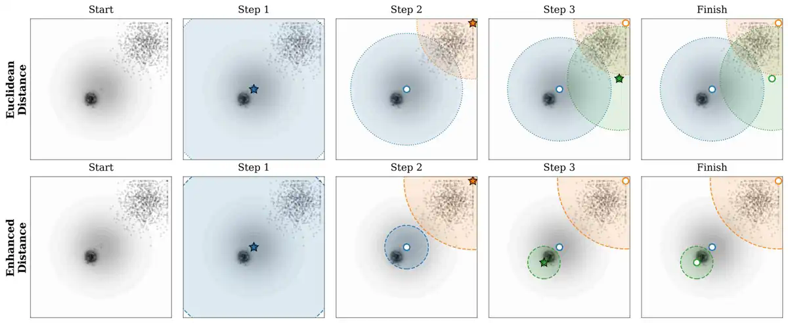
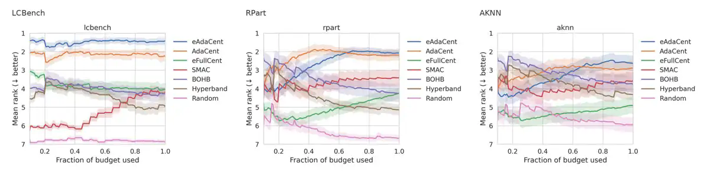
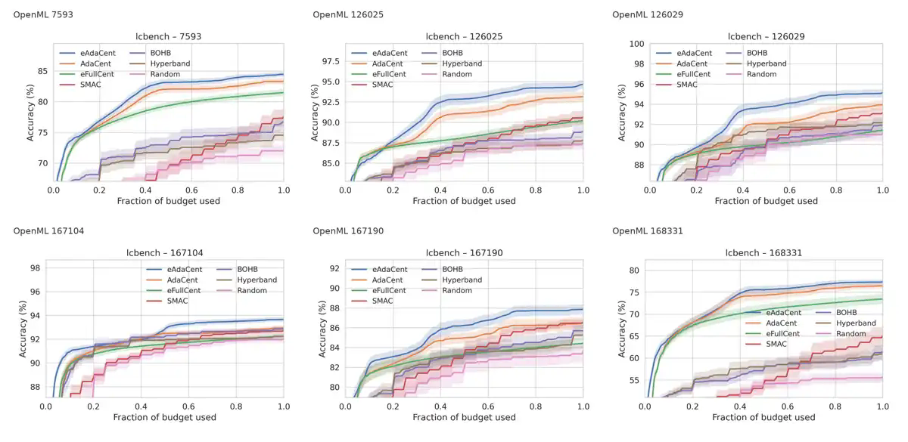
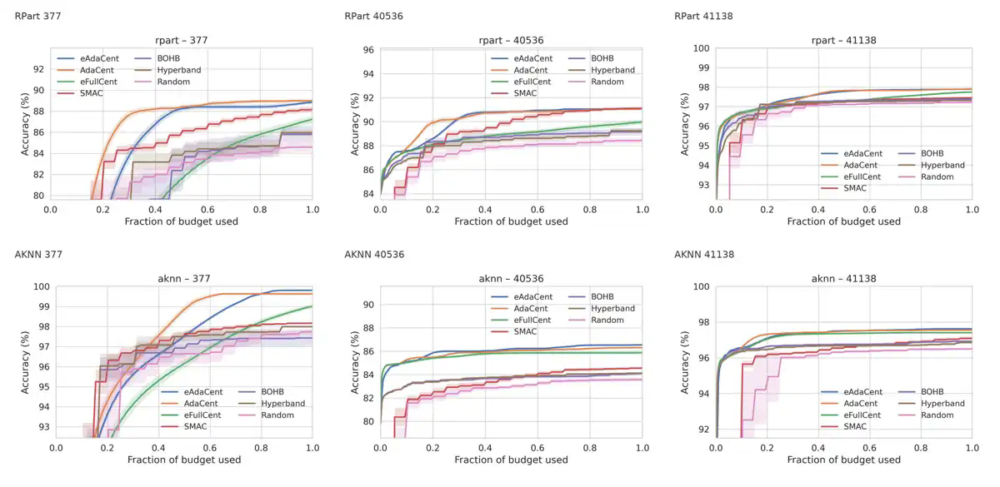

# Hyperparameter Optimization via Budget Allocation in Lipschitz Spaces

Implementation of **AdaCent**, **Enhanced-AdaCent**, and their baselines for the paper [*Hyperparameter Optimization via Budget Allocation in Lipschitz Spaces*](https://arxiv.org/pdf/2510.10605) (KDD 2027).

Hyperparameter optimization often involves many configurations whose performance is only revealed progressively as more training resources are allocated. We study **Unknown Value Probing (UVP)**: how should a finite evaluation budget be distributed over configurations when nearby configurations have related learning curves? Our methods use geometric coverage to explore the space, then adapt allocation based on observed values, using early stopping to redirect budget away from unpromising configurations.

<p align="center"></p>
<p align="center"><em>Euclidean versus enhanced-distance greedy k-center selection: value-aware coverage discourages further evaluations in low-value regions.</em></p>

## Setup

The repository contains two experimental pipelines, with **separate Python environments**: the YAHPO Gym experiments at the root and the multi-fidelity Bayesian optimization comparisons under `MFBO/`.

For the YAHPO experiments, use Python 3.10:

```bash
git clone https://github.com/alirezamirrokni/Hyperparameter-Optimization-via-Budget-Allocation-in-Lipschitz-Spaces.git
cd Hyperparameter-Optimization-via-Budget-Allocation-in-Lipschitz-Spaces
python -m venv .venv
source .venv/bin/activate
pip install -r requirements.txt
```

The [YAHPO Gym](https://github.com/slds-lmu/yahpo_gym) benchmark data must be downloaded and configured separately, following its official instructions. For the MFBO pipeline, see [MFBO/README.md](MFBO/README.md).

## Running the experiments

Run one task and seed using the per-suite configurations in `configs/`:

```bash
python -m scripts.run_benchmark --config configs/lcbench.json --task 3945 --seeds 0 --methods AdaCent EnhancedAdaCent --epsilon-samples 128
python -m scripts.run_benchmark --config configs/rbv2_rpart.json --task 377 --seeds 0 --methods AdaCent EnhancedAdaCent --epsilon-samples 128
python -m scripts.run_benchmark --config configs/rbv2_aknn.json --task 377 --seeds 0 --methods AdaCent EnhancedAdaCent --epsilon-samples 128
```

These are small smoke runs, **not** the evaluation protocol used in the paper. In particular, the reduced sample count above makes epsilon estimation faster at the expense of fidelity. The configurations specify 10,000 Sobol configurations by default. To run a multi-seed experiment, omit `--epsilon-samples`, specify the desired seeds, and optionally select all tasks:

```bash
python -m scripts.run_benchmark --config configs/lcbench.json --task 3945 --seeds 0 1 2
python -m scripts.run_benchmark --config configs/lcbench.json --all-tasks --seeds 0 1 2
```

By default, the three configuration files include the methods used for the YAHPO experiments. For the full 30-seed protocol, use `--seeds` followed by integers 0 through 29. Runs write aggregate `.npz` traces, a `plots/` directory, and `avg_traces.zip` under `outputs/<suite>/`; these generated artifacts are ignored by Git. Epsilon-estimation evaluations are separate from the optimization budget, matching the experimental description in the paper.

## Methods and layout

| Directory | Contents |
| --- | --- |
| `main/` | AdaCent, Enhanced-AdaCent, FullCent, Enhanced-FullCent and YAHPO baselines |
| `configs/` | LCBench, `rbv2_rpart`, and `rbv2_aknn` settings |
| `scripts/` | Experiment launcher |
| `MFBO/` | rMFBO, MES, KG, Random, and AdaCent multi-fidelity comparisons |
| `tests/` | Small deterministic correctness and edge-case tests |
| `assets/` | Figures from the main paper, arranged for the README |

The main implementations are in `main/AdaCent.py`, `main/EnhancedAdaCent.py`, `main/FullCent.py`, and `main/EnhancedFullCent.py`. The non-adaptive methods fully evaluate selected centers; AdaCent and Enhanced-AdaCent use early observations to guide subsequent allocation. The YAHPO comparison baselines include random search, Hyperband, BOHB, and SMAC.

## Results

We evaluate on **LCBench**, **rbv2_rpart**, and **rbv2_aknn**, covering over 250 HPO settings. The main paper reports anytime best validation accuracy across 30 random seeds and compares final performance and mean rank across tasks. The following images are assembled directly from figures in the paper's source; no result values were regenerated for this README.

**Mean rank across the budget.** Lower is better. The methods' relative rankings change over the evaluation horizon, especially on the RPart and AKNN scenarios.

<p align="center"></p>

**LCBench learning curves.** Six representative tasks from the paper:

<p align="center"></p>

**RPart and AKNN learning curves.** Three representative datasets in each scenario:

<p align="center"></p>

For exact protocols, confidence information, additional per-task figures, the synthetic functions, and the MFBO comparison, see the [paper](https://arxiv.org/pdf/2510.10605). Historical generated per-task comparison plots were intentionally removed from the working tree to keep the code repository focused; they remain in Git history.

## Checks

```bash
python -m pytest -q
python -m compileall -q main scripts MFBO
```

The deterministic tests cover code behavior, but reproducing the benchmark results requires YAHPO data and the full multi-seed setup.

## Citation

```bibtex
@article{bateni2025budgetallocation,
  title   = {Budget Allocation for Unknown Value Functions in a Lipschitz Space},
  author  = {Bateni, MohammadHossein and Esfandiari, Hossein and HosseinGhorban, Samira and Mirrokni, Alireza and Shahdaei, Radin},
  journal = {arXiv preprint arXiv:2510.10605},
  year    = {2025}
}
```
